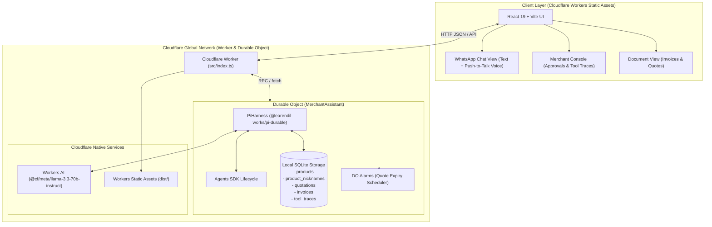

# QuoteFlow Edge ⚡📦

> **Cloudflare AI-Powered Application Assignment Submission**  
> Autonomous B2B Wholesale Merchant Agent built with **Cloudflare Workers AI (Llama 3.3 70B)**, **Cloudflare Durable Objects with Local SQLite**, and the **Cloudflare Agents SDK (`PiHarness` + `Lifecycle`)**.

---

## 🎯 Assignment Requirements Compliance Matrix

| Component | Assignment Requirement | Implementation in QuoteFlow Edge | Status |
| :--- | :--- | :--- | :---: |
| **LLM** | Recommend using Llama 3.3 on Workers AI | `@cf/meta/llama-3.3-70b-instruct` powered by Cloudflare Workers AI (`env.AI`) with zero external API keys | ✅ **Complete** |
| **Workflow / Coordination** | Workflows, Workers or Durable Objects | **Cloudflare Agents SDK (`PiHarness` + `Lifecycle`)** running inside a **Durable Object** with mid-turn crash recovery | ✅ **Complete** |
| **User Input (Chat / Voice)** | Pages or Realtime (chat or voice) | Dual-mode responsive interface: **Buyer WhatsApp Chat** with **Push-to-Talk Voice Input** + **Merchant Manager Console** | ✅ **Complete** |
| **Memory or State** | Memory or state | **Durable Object SQLite (`this.ctx.storage.sql`)** holding tables for `products`, `product_nicknames`, `quotations`, `invoices`, and `tool_traces` | ✅ **Complete** |
| **Human-in-the-Loop & Scheduling** | Multi-step agent execution & alarms | Margin breach suspension (`PENDING_APPROVAL` $\to$ Manager review) + **Durable Object Alarms (`alarm()`)** for quotation expiry | ✅ **Complete** |
| **Prompt History** | Submit prompt history | Detailed chronological AI engineering ledger provided in [`PROMPTS.md`](./PROMPTS.md) | ✅ **Complete** |

---

## 🏗️ System Architecture



---

## 🚀 Quick Start

### 1. Prerequisites
- Node.js v20+ (v25 supported)
- npm or pnpm

### 2. Install Dependencies
```bash
npm install
```

### 3. Build Frontend Assets
```bash
npm run build:client
```
*(Compiles the React frontend with Vite into `./dist`)*

### 4. Run Locally with Wrangler
```bash
npm run dev
```
*(Runs Wrangler dev with local Durable Objects, SQLite persistence, and static assets at `http://localhost:8787`)*

### 5. Deploy to Cloudflare
```bash
npx wrangler deploy
```

---

## 🧪 4 Interactive Demo Scenarios

Once running at `http://localhost:8787`, you can test these scenarios directly using the top scenario chips or voice/text input:

### Scenario 1: Trade Slang to SKU Resolution & Standard Quotation
* **Input:** `"I need 50 bags of 53 grade cement delivered to my site"`
* **What Happens:** The agent calls `search_product("53 grade")`, resolves it to `SKU-IND-CEMT-53G` (UltraTech 53 Grade OPC Cement), calls `check_margins_and_pricing`, verifies the 19% gross margin is compliant ($\ge 15\%$), and calls `generate_quotation`. An interactive `APPROVED` Quotation card renders inline.

### Scenario 2: Steep Discount Request & Human-in-the-Loop Suspension
* **Input:** `"Need 10 coils of Finolex 2.5 wire, but list price is high, can you do 1900 per coil?"`
* **What Happens:** The agent calls `check_margins_and_pricing`. Since cost is ₹1650 and list price is ₹2100, the requested ₹1900 yields only a 13.16% margin (below the required 16% threshold). The agent marks the quotation as `PENDING_APPROVAL` and politely informs the customer that their request is under review.
* **Manager Action:** Switch to the **Merchant Console** tab. The quote appears in the **Margin Approvals Queue**. The manager can either click **"Approve Requested Discount"** or enter a revised rate (e.g. ₹1980) and click **"Counter Offer"**. The Durable Object immediately resumes the agent loop and alerts the buyer.

### Scenario 3: Conversational Confirmation to Official Tax Invoice
* **Input:** `"Haan theek hai, confirm and invoice bana do"`
* **What Happens:** The agent recognizes confirmation of the active approved quote, invokes `convert_to_invoice`, records the tax invoice in SQLite, and displays the formal Tax Invoice card with a printable document modal.

### Scenario 4: Autonomous Colloquial Nickname Learning
* **Input:** `"Hum log Tata Tiscon saria ko 'tata rod' bolte hai, yaad rakhna"`
* **What Happens:** The agent invokes `add_product_nickname(sku: "SKU-IND-STEEL-12MM", nickname: "tata rod")` and stores it in the Durable Object SQLite database. Future searches for *"tata rod"* resolve immediately to the rebar SKU.

---

## 🛠️ Project Structure

```
rainsong/
├── client/                      # Frontend Application (React 19 + Vite + Tailwind)
│   ├── index.html               # Main HTML template
│   └── src/
│       ├── components/
│       │   ├── TopNav.tsx       # Cloudflare status badges & view switcher
│       │   ├── WhatsAppChat.tsx # Conversational commerce & voice input
│       │   ├── MerchantConsole.tsx # Human-in-the-loop approvals & tool trace
│       │   └── DocumentModal.tsx# Printable Invoice/Quotation viewer
│       ├── App.tsx              # Root application coordinator
│       └── main.tsx             # React entry point
├── src/                         # Cloudflare Edge Backend (Worker & Durable Object)
│   ├── agent/
│   │   └── merchant-system-prompt.ts # Dynamic Llama 3.3 prompt extension
│   ├── db/
│   │   ├── schema.ts            # SQLite schema definitions
│   │   ├── seed.ts              # Pre-seeded catalog & trade nicknames
│   │   └── sqlite-store.ts      # Durable Object SQLite DAO (storage.sql)
│   ├── tools/
│   │   └── merchant-tools.ts    # Pi Tools (search, margin, quote, invoice, nickname)
│   ├── shared/
│   │   └── types.ts             # Domain interfaces & shared types
│   └── index.ts                 # Durable Object (PiHarness) & Worker router
├── dist/                        # Compiled production frontend assets
├── wrangler.toml                # Cloudflare Worker, DO, and Workers AI configuration
├── PROMPTS.md                   # Chronological AI engineering prompt history
└── package.json                 # Dependencies (agents, pi-durable, pi-ai, chord)
```

---

## 📄 License
MIT
